# AWS 사전 준비 가이드 (수업 전 배포용)

> **대상**: AWS 트랙으로 참여하고 싶은 학생. 로컬 트랙만으로도 수업은 완결되니, 아래가 부담스러우면 안 해도 된다 — 그 경우 수업 당일 자동으로 로컬 트랙으로 진행된다.
> **완료 기준**: 맨 아래 "완료 확인" 섹션의 두 캡처를 수업 시작 전까지 제출한다.

---

## 0. 전체 순서 요약

1. AWS 계정 생성 (프리티어)
2. 결제 알림(Billing Alarm) 설정 — 예산 안전장치
3. IAM 사용자 생성 (루트 계정 대신 쓸 계정)
4. Access Key 발급
5. AWS CLI 설치 + 자격 증명 등록
6. RDS for PostgreSQL 인스턴스 생성 (수업 중에는 생성할 시간이 없어 **반드시 사전에** 끝내야 함)
7. (선택, 보통 필요 없음) EC2 키페어(.pem)

---

## 1. AWS 계정 생성 (프리티어)

1. https://aws.amazon.com → "AWS 계정 생성"
2. 이메일, 계정 이름, 비밀번호 입력
3. 결제 정보(신용/체크카드) 등록 — 프리티어 범위 내에서는 과금되지 않지만, 카드 등록 자체는 필수
4. 본인 확인(전화/SMS) 완료
5. 지원 플랜은 "기본(Basic) 지원 — 무료"로 선택

---

## 2. 결제 알림(Billing Alarm) 설정 — 반드시 먼저 할 것

가입 직후, 실수로 과금되는 걸 막기 위한 안전장치.

1. 콘솔 우측 상단 계정명 → "결제 및 비용 관리(Billing)"
2. 왼쪽 메뉴 "예산(Budgets)" → "예산 생성"
3. 템플릿: "제로 지출 예산(Zero spend budget)" 선택 — $0.01만 초과해도 알림
4. 알림 받을 이메일 입력 → 생성

---

## 3. IAM 사용자 생성 (루트 계정을 직접 쓰지 않는다)

루트 계정은 모든 권한을 가진 "슈퍼 관리자"라 평소 작업에 쓰면 위험하다. 실습용 IAM 사용자를 따로 만든다.

1. 콘솔에서 "IAM" 검색 → IAM 대시보드 → 왼쪽 메뉴 "사용자(Users)" → "사용자 생성"
2. 사용자 이름 입력 (예: `aws-claude-cli-project`), "AWS Management Console 액세스 제공"은 체크 안 해도 됨 (CLI만 쓸 거라서):

   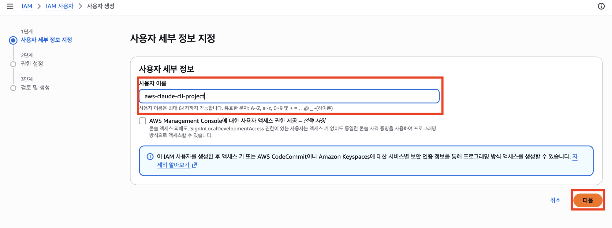

3. "다음" → 권한 설정 화면에서 **"그룹에 사용자 추가"**(기본 선택값) 그대로 둔다. 기존 그룹이 없으면 "그룹 생성":

   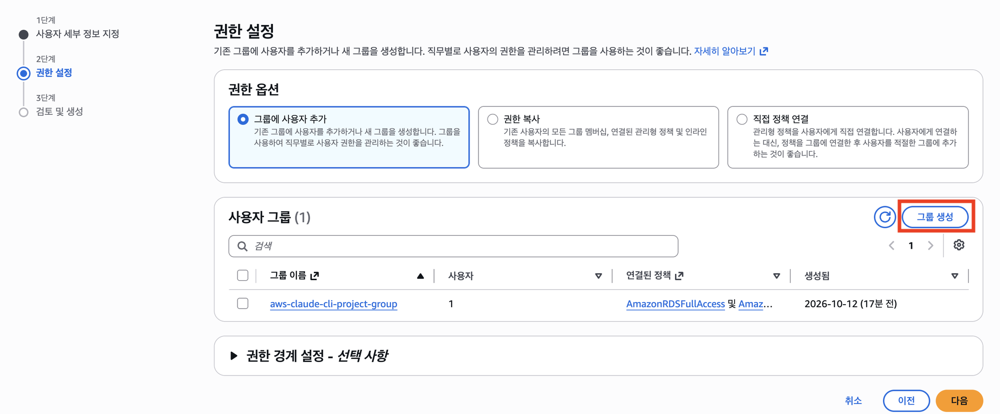

4. 그룹 이름을 정하고, 정책 검색창에 `AmazonRDSFullAccess` 검색 후 체크:

   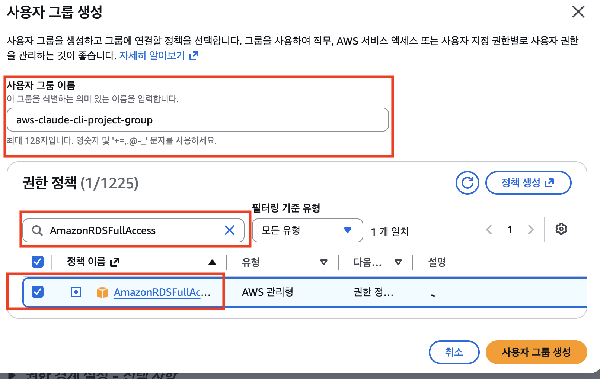

   (VPC가 없는 계정이라 아래 "조건부 추가"에 해당하면) 검색창을 지우고 다시 `AmazonVPCFullAccess` 검색 후 체크:

   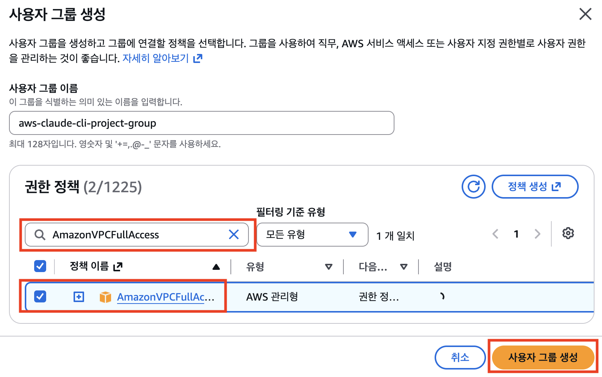

   검색창을 지워도 선택한 개수(우측 상단 `2/1225`처럼)는 그대로 유지된다:

   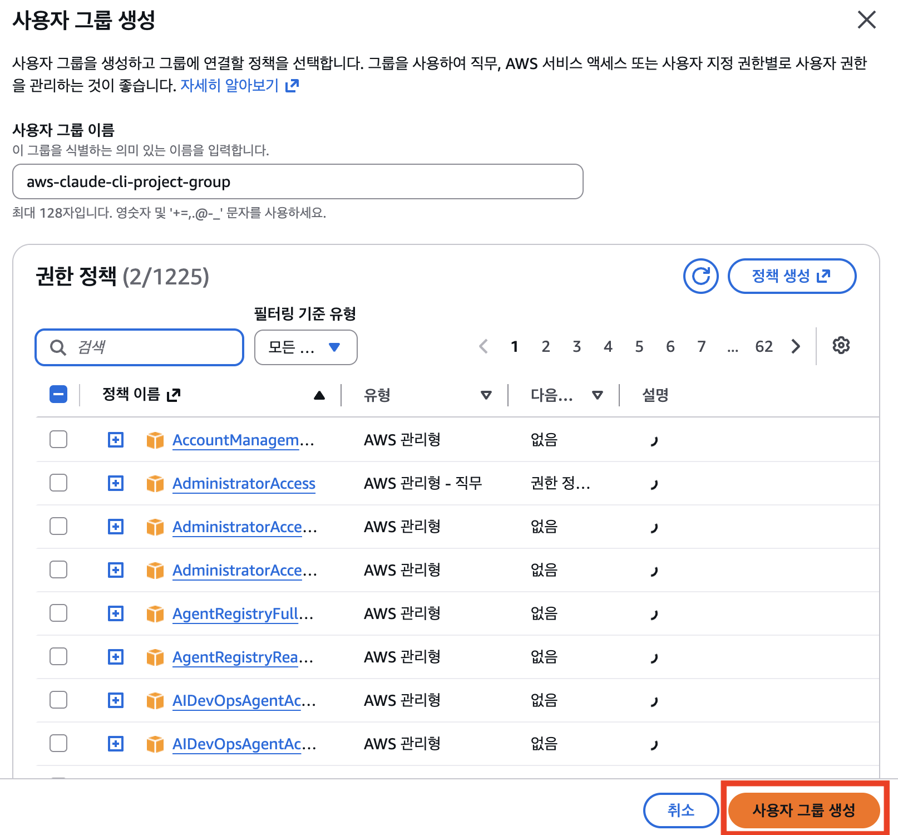

5. "사용자 그룹 생성" 클릭 → 권한 설정 화면으로 돌아오면 방금 만든 그룹이 체크된 채로 보이고, 연결된 정책도 확인된다:

   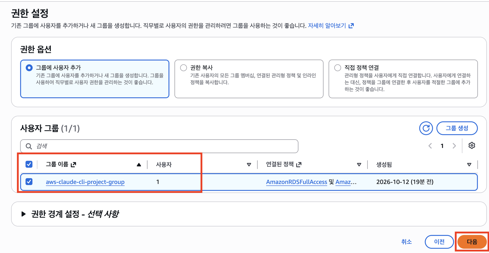

6. "다음" → "사용자 생성" 클릭 → 사용자 목록에서 생성된 사용자 확인:

   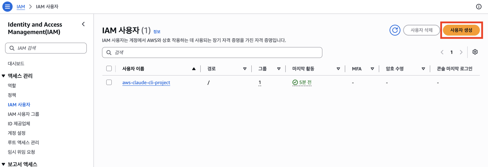

> **조건부 추가 — "계정에 VPC가 하나도 없다"는 에러가 나면**: 보통 모든 AWS 계정/리전엔 기본 VPC가 자동으로 있어서 위 두 정책만으로 충분하다. **대부분의 학생은 이 박스를 그냥 건너뛰어도 된다.** 하지만 이전에 리전의 기본 VPC까지 완전히 정리(`aws_cleanup.md` Phase A)한 적이 있다면, RDS를 띄울 VPC·서브넷·인터넷 게이트웨이·보안 그룹을 처음부터 새로 만들어야 하는데 이건 `AmazonRDSFullAccess`만으로는 권한이 부족하다(`ec2:CreateVpc`, `ec2:CreateSubnet` 등은 별도 권한). 이럴 땐 그룹에 **`AmazonVPCFullAccess`**를 추가로 연결한다 — IAM 콘솔 → "IAM 사용자 그룹" → 해당 그룹 → "권한" 탭 → "권한 추가" → "정책 연결" → `AmazonVPCFullAccess` 검색 후 연결. 연결 후 화면은 이렇게 두 정책이 보이면 성공:
>
> 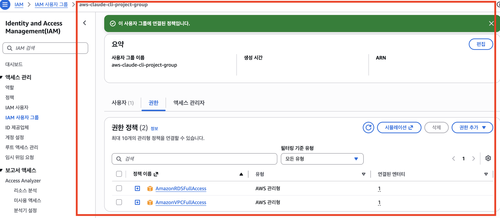

> 수업 실습에서 `hooks/block-paid-resource.sh`가 "프리티어 벗어난 요청 차단"을 보여줄 거라, 권한을 넓게 주더라도 실제로는 훅이 막아주는 구조를 체험하게 된다. 권한 자체를 더 좁히고 싶다면 `AmazonRDSFullAccess` 대신 특정 리전·인스턴스 타입만 허용하는 커스텀 정책을 써도 된다(선택 사항).

---

## 4. Access Key 발급

> **"Access Key가 어디 있지?" 싶을 때**: IAM 콘솔 → "사용자" → 내가 만든 사용자 클릭 → "보안 자격 증명" 탭 → "액세스 키" 섹션에서 찾는다. 이미 만든 적이 있다면 Access Key ID는 거기서 다시 보이지만, **Secret Access Key는 생성 당시 한 번만 보여주고 그 뒤로는 절대 다시 안 보여준다** — 잃어버렸으면 그 키를 쓸 방법은 없고, **그냥 새 액세스 키를 하나 더 만들면 된다**(기존 건 안 쓰면 삭제해도 그만).

1. 방금 만든 사용자 클릭 → 사용자 세부 정보 화면(요약에 ARN, 액세스 키 개수 등이 보인다):

   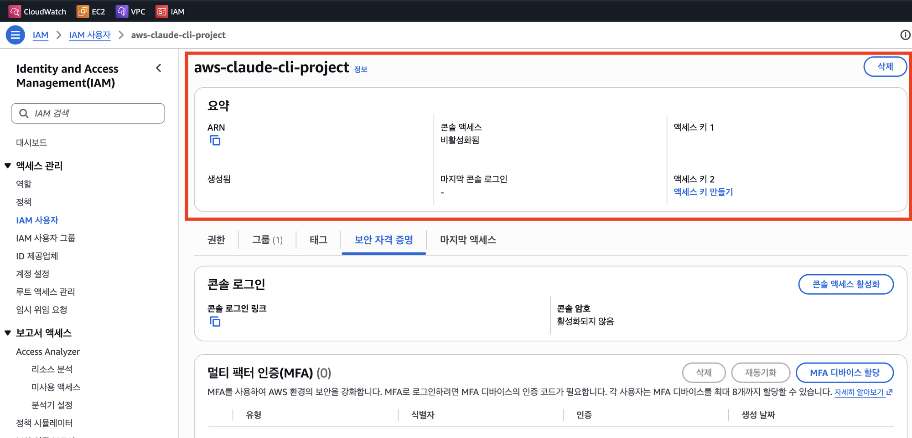

2. "보안 자격 증명(Security credentials)" 탭 → "액세스 키" 섹션:

   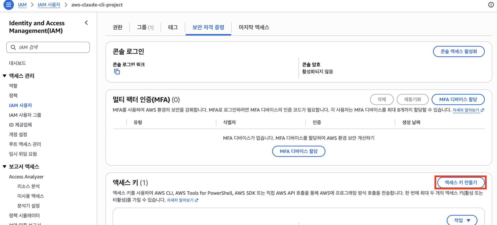

3. "액세스 키 만들기(Create access key)" → 사용 사례: "Command Line Interface(CLI)" 선택 → 안내문 확인 체크 → "다음":

   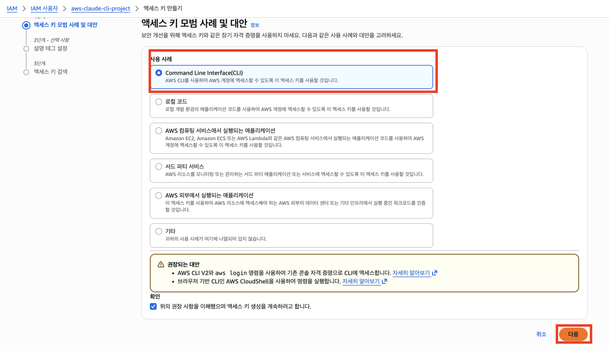

4. 설명 태그(선택 사항) — 비워두고 "액세스 키 만들기":

   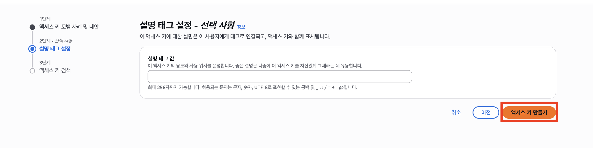

5. **Access Key ID**와 **Secret Access Key**가 한 번만 표시된다 — 반드시 안전한 곳에 복사해둘 것 (다시 볼 수 없음). **이 화면은 절대 캡처해서 공유하지 않는다 (Secret 값이 보이는 유일한 순간).**

---

## 5. AWS CLI 설치 + 자격 증명 등록

### 설치
- **macOS**: `brew install awscli` (Homebrew 없으면 https://aws.amazon.com/cli/ 에서 pkg 설치파일 다운로드)
- **Windows**: https://aws.amazon.com/cli/ 에서 MSI 설치파일 다운로드 후 실행
- **Linux**: `curl "https://awscli.amazonaws.com/awscli-exe-linux-x86_64.zip" -o "awscliv2.zip" && unzip awscliv2.zip && sudo ./aws/install`

### 설치 확인
```bash
aws --version
```

### (먼저) 이미 등록돼 있는지 확인
```bash
ls ~/.aws/           # 폴더 자체가 없으면 아직 한 번도 설정 안 한 것
aws sts get-caller-identity   # "Unable to locate credentials" 에러면 미등록
```

### 자격 증명 등록
```bash
aws configure
```
다음 네 가지를 순서대로 입력:
```
AWS Access Key ID [None]: <4번에서 발급받은 Access Key ID>
AWS Secret Access Key [None]: <4번에서 발급받은 Secret Access Key>
Default region name [None]: ap-northeast-2    # 서울 리전
Default output format [None]: json
```

### 확인
```bash
aws sts get-caller-identity
```
아래와 비슷한 결과가 나오면 성공 — **이 화면을 캡처해서 제출한다.**
```json
{
    "UserId": "AIDAxxxxxxxxxxxxxxxxx",
    "Account": "123456789012",
    "Arn": "arn:aws:iam::123456789012:user/apt-capstone-user"
}
```

---

## 6. RDS for PostgreSQL 인스턴스 생성 (수업 전에 반드시 완료)

수업 실습(90분)에는 인스턴스 생성(수 분~십여 분 소요)까지 넣을 시간이 없다. **인스턴스를 미리 만들어서 "Available" 상태로 대기시켜 놓는다.**

1. 콘솔에서 "RDS" 검색 → "데이터베이스 생성"
2. 엔진 옵션: **PostgreSQL**
3. 템플릿: **프리 티어(Free tier)** — 반드시 이걸 선택해야 과금 안 됨
4. DB 인스턴스 식별자: `apt-capstone-db` (자유롭게 지어도 됨)
5. 마스터 사용자 이름/암호: 직접 설정하고 기억해둘 것
6. 인스턴스 구성: `db.t3.micro` 또는 `db.t4g.micro` (프리 티어 템플릿 선택 시 자동으로 이쪽만 고를 수 있게 됨)
7. 스토리지: 기본값(프리 티어는 20GB까지 무료)
8. 연결 — **퍼블릭 액세스: "예"**로 설정 (로컬 Docker 환경에서 바로 접속하기 위함 — 보안그룹에서 본인 IP만 허용하면 안전)
9. VPC 보안 그룹: 새로 생성 → 인바운드 규칙에서 "내 IP"만 PostgreSQL(5432) 포트 허용
10. "데이터베이스 생성" 클릭 → 상태가 "Available"이 될 때까지 대기 (보통 5~10분)

### 완료 후 확인할 것
- RDS 콘솔에서 인스턴스 상태: **Available**
- "연결 & 보안" 탭의 **엔드포인트(Endpoint)** 주소 — 수업에서 `.env.aws`에 넣을 값이니 따로 메모해둘 것

---

## 7. (선택, 보통 필요 없음) EC2 키페어(.pem)

이번 캡스톤은 **RDS + 로컬 Docker** 구조라 EC2 서버에 직접 접속(SSH)할 일이 없다. 그래서 **EC2 키페어(.pem 파일)는 기본적으로 필요 없다.**

다만 혹시 수업 중 "EC2에 올려서 돌려보자"는 흐름으로 바뀌면 그때 아래 과정이 필요해진다 — 참고용으로만 적어둔다.

1. EC2 콘솔 → "키 페어" → "키 페어 생성"
2. 이름 입력, 키 페어 유형: RSA, 프라이빗 키 형식: `.pem` (Mac/Linux) 또는 `.ppk`(Windows PuTTY용)
3. 생성 시 자동으로 다운로드되는 `.pem` 파일을 안전하게 보관 (다시 다운로드 불가)
4. 권한 설정(Mac/Linux): `chmod 400 my-key.pem`
5. SSH 접속: `ssh -i my-key.pem ec2-user@<EC2 퍼블릭 IP>`

---

## 완료 확인 (수업 전 제출)

1. `aws sts get-caller-identity` 실행 결과 캡처
2. RDS 콘솔의 인스턴스 상태 "Available" 화면 캡처 + 엔드포인트 주소

이 두 가지가 없으면 수업 당일 **자동으로 로컬 트랙**으로 진행된다 — 전혀 불이익이 아니다, 최종 결과물(대시보드)은 로컬 트랙도 동일하게 완성된다.
